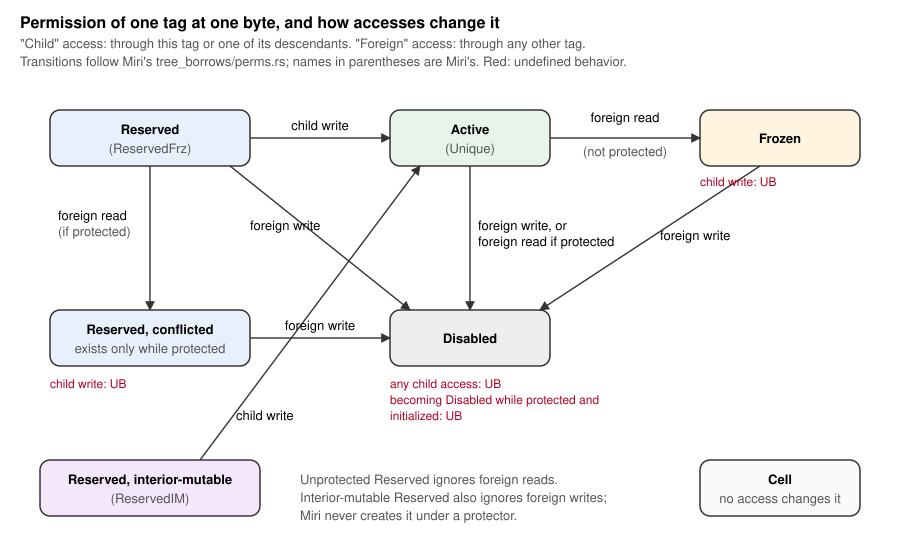
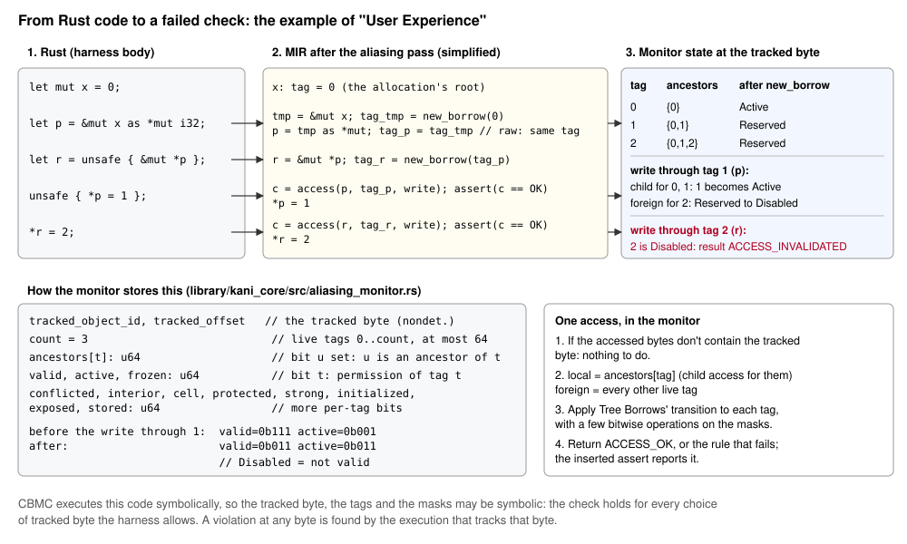
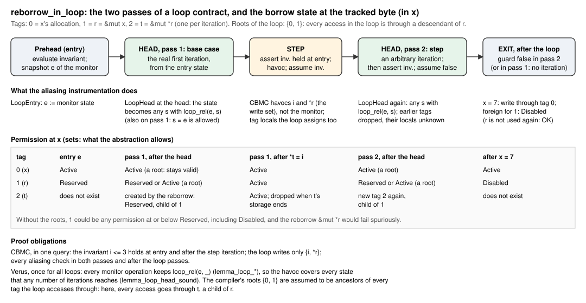
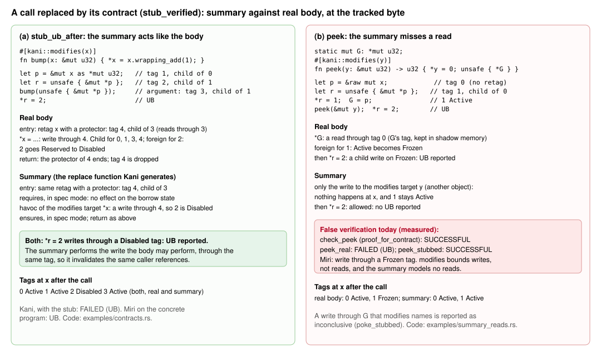

- **Feature Name:** Aliasing checks (`aliasing-checks`)
- **Feature Request Issue:** [#314](https://github.com/model-checking/kani/issues/314)
- **RFC PR:** [#5111](https://github.com/model-checking/kani/pull/5111)
- **Status:** Under Review
- **Version:** 0
- **Proof-of-concept:** branch [`aliasing-core`](https://github.com/feliperodri/kani/tree/aliasing-core); contracts support on [`aliasing-contracts`](https://github.com/feliperodri/kani/tree/aliasing-contracts)

-------------------

## Summary

A new check, `-Z aliasing-checks`, reports memory accesses that break Rust's aliasing rules, as
defined by Tree Borrows, the aliasing model Miri implements. A harness that verifies with the
check enabled has no execution that violates those rules, or Kani reports the access it could not
check.

## User Impact

Kani's main audience writes or audits `unsafe` code, and today Kani misses a whole class of
undefined behavior there. Code that writes through a `*mut T` while a `&T` to the same memory is
alive, or uses a reference after another path invalidated it, verifies today, even though it is
undefined behavior. The compiler optimizes based on these rules, so such code can miscompile.
Miri finds these bugs, but only on the inputs a test runs. Kani can check them for all inputs a
harness covers.

What users get:
- the aliasing rules checked on every execution a harness covers, alongside Kani's existing
  memory-safety checks;
- harnesses that already exist, such as those of the verify-rust-std challenges, check aliasing
  with one extra flag;
- a check that never reports success for an access it could not follow. It gives up instead,
  with a message that says so;
- the check works with loop and function contracts, so unbounded loops and recursive functions
  can be verified free of aliasing violations, not only up to an unwinding bound.

The downsides:
- **Cost:** the checks are expensive. On the verify-rust-std challenges we ran, harnesses take 10
  to 20 times longer with the checks than without, and a few run out of memory (see "Current
  results" below).
- **Inconclusive results:** some programs can't be checked yet, for example `&self` method calls
  through `&dyn Trait`. Those results are inconclusive, so users will see failures that aren't
  bugs and will need to read the message to tell them apart.
- **Only Tree Borrows:** the rules are Tree Borrows'. Programs that only Stacked Borrows rejects
  pass. Rust has not adopted an official aliasing model, and a future official model may differ
  from both.

## User Experience

The check is enabled with `-Z aliasing-checks`, for `kani`, `cargo kani`, `kani verify-std` and
`autoharness`. No library API or attribute changes. Existing harnesses work as they are, including
those with loop contracts and function contracts: users don't write anything about tags or
permissions in invariants, `requires`, `ensures` or `modifies`.

```rust
#[kani::proof]
fn check() {
    let mut x = 0;
    let p = &mut x as *mut i32;
    let r = unsafe { &mut *p };
    unsafe { *p = 1 }; // The write through `p` invalidates `r`...
    *r = 2;            // ...so writing through `r` is undefined behavior.
}
```

```
Failed Checks: Undefined Behavior: memory accessed through a reference or pointer whose borrow was invalidated by a conflicting access (aliasing checks)
```

Each kind of violation has its own message, ending with "(aliasing checks)":
- an access through an invalidated reference or pointer;
- a write through a pointer that only has read permission, derived from a shared reference or
  from a mutable reference frozen by a later read;
- a write that invalidates a reference argument of a function that is still running (protector);
- deallocating memory that a reference argument of a running function points to;
- an access through a pointer created from an integer that no exposed pointer allows.

When the check cannot tell which reference a pointer comes from, the access fails with:

```
Failed Checks: Kani's aliasing checks do not know which reference this pointer was derived from, so they cannot check this access
```

This result is inconclusive: it is not a proof of undefined behavior. It is reported as a failure
so that a successful verification never depends on an access the check skipped. The user
documentation lists the constructs that lead to it.

Like `-Z uninit-checks`, the check tracks the state of one byte of memory per execution, chosen
nondeterministically, so if any byte is accessed against the rules, some execution tracks it and
the check fails. The trace shows that execution.

## Software Design

This section explains the design from the ground up: the parts of Tree Borrows it relies on, how
`kani-compiler` turns a program's borrow events into calls to a monitor, what the monitor computes
and what is proved about it, and how the checks combine with loop and function contracts. Source
links point to the proof-of-concept at commit
[`9c7a473f8`](https://github.com/feliperodri/kani/tree/9c7a473f8) of branch `aliasing-contracts`;
the monitor and its proof are also in PR [#5120](https://github.com/model-checking/kani/pull/5120).
Runnable versions of every example are in [`0016-aliasing-checks/examples`](0016-aliasing-checks/examples).

### Tree Borrows, as far as this design needs it

Tree Borrows (Villani, Hostert, Dreyer and Jung, PLDI 2025) is an aliasing model
for Rust that Miri implements. We follow Miri's implementation
([`tree_borrows/perms.rs`](https://github.com/rust-lang/miri/blob/25cfa611ce37/src/borrow_tracker/tree_borrows/perms.rs),
[`tree.rs`](https://github.com/rust-lang/miri/blob/25cfa611ce37/src/borrow_tracker/tree_borrows/tree.rs)),
which is what users test against.

- **Tags.** Every pointer value carries a *tag*. Creating a reference (`&x`, `&mut x`, `&mut *p`),
  and retagging the references and `Box`es a function receives as arguments, creates a new tag
  whose *parent* is the tag of the pointer it was derived from. Each allocation starts with one
  root tag. Raw pointers created from a reference (`r as *mut T`, `&raw mut *r`) keep the
  reference's tag; they don't get a new one.
- **The tree.** Parent links make the tags of an allocation a tree. A tag's parent is fixed when
  the tag is created and never changes.
- **Permissions.** For every byte, each tag has a *permission*:

  | Permission (Miri's name) | Meaning |
  |---|---|
  | Reserved (`ReservedFrz`) | a `&mut` that hasn't been written yet |
  | Reserved, conflicted (`ReservedFrz { conflicted: true }`) | a protected Reserved that saw a foreign read: writing through it is UB |
  | Reserved, interior-mutable (`ReservedIM`) | an unprotected `&mut` to a type with `UnsafeCell` |
  | Active (`Unique`) | a `&mut` that has been written |
  | Frozen | a shared reference, or a `&mut` that saw a foreign read after it was written |
  | Disabled | invalidated: any access through it is UB |
  | Cell | a shared reference to the bytes of an `UnsafeCell`: no access changes it |

- **Accesses.** A read or write through tag `t` is a *child* access for `t` and its ancestors,
  and a *foreign* access for every other tag. Each tag's permission then changes as shown below.
  An access is UB if it changes some tag in a way the rules forbid, for example a child write on a
  Frozen tag.
- **Reborrows read.** Creating a reference performs a read through its parent, except for a shared
  reference's `UnsafeCell` bytes.
- **Protectors.** While a function runs, the tags of its reference arguments are *protected*
  (strongly for references, weakly for `Box`es). A foreign access that would disable a protected
  tag whose permission at that byte is initialized is UB, and so is deallocating memory a strongly
  protected tag points to. When the protector ends, Miri performs a read (or a write, if the tag
  is Active) through the tag, which its descendants don't see.
- **Lazy initialization.** A tag's permission at a byte is *initialized* once it is accessed there.
  Some rules only apply to initialized permissions.
- **Wildcards.** A pointer created from an integer may carry any tag that was exposed (by a
  pointer-to-integer cast). Accesses through it use Miri's *wildcard* rules.



**Two facts the loop abstraction relies on.** Both are about the tags that exist at a given point,
at one byte:

1. *Permissions only move one way.* Miri orders permissions by
   `Reserved < Reserved conflicted < Active < Frozen < Disabled` (interior-mutable Reserved and
   Cell are incomparable with the rest) and documents that this order is exactly reachability by
   transitions, which an exhaustive test checks
   ([`perms.rs`](https://github.com/rust-lang/miri/blob/25cfa611ce37/src/borrow_tracker/tree_borrows/perms.rs),
   `permissionpriv_partialord_is_reachability`). For our transcription of the rules, Verus proves
   that each local and foreign transition moves a permission forward in this order
   ([`lemma_steps_monotone`](https://github.com/feliperodri/kani/blob/9c7a473f8/library/kani_core/verus/aliasing_monitor.rs#L2613)).
2. *Ancestors never change.* No operation re-parents an existing tag.

The other per-tag facts do change during a run, and the design doesn't treat them as fixed:
protectors start and end with calls, `initialized`, exposed and stored flags get set, and tags are
created and dropped.

### Overview



The checks have three parts:
- **Instrumentation** (`kani-compiler`): a MIR pass gives every pointer a *tag local*, and inserts
  calls to the monitor at every borrow event.
- **The monitor** (`library/kani_core`): ordinary Rust code that keeps the Tree Borrows state of
  one byte of memory and applies the rules. Each call returns `ACCESS_OK` or the rule that failed,
  and the instrumentation asserts the result.
- **CBMC** executes the instrumented program symbolically, as for any harness. The tracked byte is
  chosen nondeterministically when the harness starts, so the assertions hold for every byte the
  program accesses, or CBMC reports an execution where one fails.

### What a tag is, and where Kani keeps it

A tag is a small number (`u8`) that names a node of the tree at the tracked byte. Tag 0 is the
allocation's root, tags are numbered in creation order, and at most 64 are alive at once. Two
special values exist: *unknown*, for a pointer whose origin the instrumentation lost, and
*exposed*, for a pointer created from an integer.

Kani doesn't change pointer values. Instead, each pointer the program holds has a ghost variable
next to it holding its tag:
- **In a local variable** (or a field of one): a *tag local* that the pass adds to the function.
  Assignments, casts and field moves copy tag locals along with the pointers.
- **In memory** (a pointer in a `Box`, a `Vec`, a struct behind a reference): the tag goes into
  CBMC's *shadow memory* at the pointer's address, and is read back when the pointer is loaded.
  A write the instrumentation can't follow (a C function, the havoc of a loop or function
  contract) invalidates the stored tags; pointers loaded afterwards have the unknown tag.

An access through a pointer with the unknown tag is reported as inconclusive: the verification
fails with "Kani's aliasing checks do not know which reference this pointer was derived from",
never passes.

### Instrumentation

The pass is `kani_middle/transform/check_aliasing.rs`
([`statement_actions`](https://github.com/feliperodri/kani/blob/9c7a473f8/kani-compiler/src/kani_middle/transform/check_aliasing.rs#L1507),
[`terminator_actions`](https://github.com/feliperodri/kani/blob/9c7a473f8/kani-compiler/src/kani_middle/transform/check_aliasing.rs#L1769)).
It runs on every function the harness reaches, except Kani's own functions and the monitor. The
events it captures:

| Category | MIR construct | What the pass inserts |
|---|---|---|
| Tag creation | `Rvalue::Ref` (not fake borrows; not `&mut` to a `!Unpin` type, as in Miri) | a read through the parent, then `new_borrow(parent)` |
| | function entry: references and `Box`es among the arguments, also inside structs and tuples | `new_borrow` with a protector (weak for `Box`) |
| | `Rvalue::Use` with retag (a copy Miri retags) | `new_borrow` for the references and `Box`es in the value |
| | `Drop` of a place | a reborrow passed to the drop glue |
| | a new heap allocation (`__rust_alloc`, ...) | the allocation's root tag |
| Tag propagation | `&raw const`/`&raw mut`, pointer casts, `Use`/`Copy`/`Move`, aggregates, field projections | copies of tag locals; no new tag |
| Accesses | every place read or written through a dereference, in statements and in terminator operands | `access(place, tag, read/write)` |
| | reading or setting an enum discriminant | an access to the bytes of the discriminant |
| | `copy_nonoverlapping` and the memory intrinsics (`copy`, `write_bytes`, volatile and atomic accesses, ...) | `access_count` over the bytes they touch |
| Deallocation | `__rust_dealloc`, `__rust_realloc` | a write access, then the protected-deallocation check |
| Calls and returns | direct calls (and `dyn` calls, by trait method) | the argument tags go to the callee through a call buffer (8 tags); returned pointers' tags (4) come back the same way |
| | `Return` | the protectors of the arguments end; the function's tags are dropped, except returned, stored or exposed ones |
| | `StorageDead` of a reference nothing else holds the tag of | its tag is dropped |
| Pointers in memory | writes of values containing pointers; writes the pass can't follow | `store_tag`; `forget_tags` / `forget_all` |
| Interior mutability | references to types with `UnsafeCell`: which bytes are inside one, for the first 64 bytes | per-byte Cell permissions; an unknown layout gives the unknown tag |
| Exposure | pointer-to-integer casts; integer-to-pointer casts | `expose(tag)`; the exposed tag |
| C functions | `memset`, `memcpy`, `memmove`, `memcmp`, `bcmp`, `strlen` | `access_count` for the bytes they read or write |
| | any other foreign function | fails as unsupported if reached |
| Specifications | contract clauses, loop invariants, the havoc of a replaced call | spec mode (below) |
| Not checked, by design | standard-library functions that can only panic (return `!`, not `exit`/`abort`), unless a harness is `should_panic` | spec mode for them and their callees |

**Why this is complete, and what isn't established.** The pass matches every kind of MIR statement,
rvalue and terminator exhaustively, without wildcard patterns, so a new kind of MIR construct is a
compile error, not a silent gap. Each construct is either instrumented, has no effect on Tree
Borrows (storage markers, `PlaceMention`, fake reads), or fails as unsupported when reached.
Pointers whose provenance the pass loses get the unknown tag, which makes the result inconclusive.
This is an argument from the structure of the code and from tests, not a proof:
- Tests: Kani's `tests/expected/aliasing` (76 tests), and 363 tests from Miri's own test suite run
  under both tools. On the latter, there is no test where Miri reports a Tree Borrows violation
  and Kani reports success, and none where Kani reports an aliasing violation and Miri accepts the
  program. Of the 363, 133 are UB under both tools and 90 pass under both; 44 are inconclusive;
  24 run out of memory at 6 GiB, 20 crash Kani or CBMC, 11 reach the unwinding bound and 3 use
  unsupported constructs. 32 are other kinds of UB (invalid references at creation, uninitialized
  reads, ...) that Kani's other checks don't catch either, and 6 are other disagreements unrelated
  to aliasing.
- Known gaps, all of which make results inconclusive rather than wrong: `&self` calls through
  `&dyn Trait` and calls through function pointers don't pass tags; multi-element copies of
  pointer-holding values, transmutes through bytes and more than 8 pointer arguments lose them.
- One known false alarm: `addr_of!(*p)` on a pointer without provenance is checked like creating
  a reference, which Miri doesn't do.

Missing instrumentation would be a soundness bug. That's why every construct the pass doesn't
handle is either reported or provably irrelevant.

**Calls and C.** Tags cross Rust calls through the call buffer, keyed by the callee (or the trait
method, for `dyn` calls), so a callee whose caller didn't record tags gets unknown tags. Calls to C
are only modeled for the C library functions above. Any other foreign call fails as unsupported,
and it also invalidates every tag stored in memory, since C may write anywhere. Wider C support
would come with Kani's C-FFI work ([milestone](https://github.com/model-checking/kani/milestone/30))
and is future work.

### The monitor

The monitor is the `kani_aliasing_monitor!` macro in
[`library/kani_core/src/aliasing_monitor.rs`](https://github.com/feliperodri/kani/blob/9c7a473f8/library/kani_core/src/aliasing_monitor.rs).
For the tracked byte it keeps, for each live tag `t < count`:
- `ancestors[t]`, a 64-bit set of its ancestors;
- bits for its permission: `valid`, `active`, `frozen`, `conflicted`, `interior`, `cell` (Disabled
  is not valid; Frozen is valid and frozen; Active is valid, active and not frozen; otherwise
  Reserved, with the conflicted and interior variants);
- bits for `protected`, `strong`, `initialized`, `exposed` and `stored`.

An access through `t` computes the child set (`ancestors[t]`) and the foreign set (the other live
tags) and applies the transition of the first figure to all of them with a few bitwise operations
([`monitor_apply`](https://github.com/feliperodri/kani/blob/9c7a473f8/library/kani_core/src/aliasing_monitor.rs#L207)).
A reborrow past 64 live tags gets the unknown tag, so the bound can make a result inconclusive but
can't make it pass.

**Reclaiming tags.** Tags are dropped once nothing can reach them, so that loops don't run into the
bound: a returning function drops the tags it created, except the ones it returns, stores in memory
or exposes; and a reference nothing else holds the tag of (assigned once by a reborrow, and
otherwise only used through a dereference) has its tag dropped when its storage ends. Only the most
recent tag is dropped, so a tag with a live child stays. Whether nothing else holds a tag is
decided by the instrumentation, which is not proved (see "Key soundness concerns").

**Code that can only panic** is not checked: a standard-library function that never returns, other
than `exit` and `abort`, runs with the monitor off, and so do its callees. These are the functions
that build a panic message on the way to the panic. The execution fails at that panic anyway, so
skipping them can't turn a failure into a success; it only hides undefined behavior inside panic
formatting. Harnesses with `#[kani::should_panic]` keep the checks there, since an expected panic
isn't a failure.

**What is proved, and what is only tested.** Two different claims support the monitor:

1. *The monitor implements our specification* (proved). A Verus crate
   ([`library/kani_core/verus`](https://github.com/feliperodri/kani/blob/9c7a473f8/library/kani_core/verus/aliasing_monitor.rs))
   includes the same macro, so the proof is about the code Kani runs. It defines an abstract state
   (trees of tags, each with a permission) and an abstraction function from the bit masks to it,
   and proves, for each monitor function, that its result and new state refine the specification
   and keep a well-formedness invariant (`monitor_wf`). 163 obligations verify with no `assume`,
   `admit` or `external_body`.
2. *Our specification is Tree Borrows* (tested, not proved). The specification is a transcription
   of Miri's code, rule by rule:

   | Tree Borrows rule (Miri) | Monitor function | Specification | Evidence beyond the proof |
   |---|---|---|---|
   | child and foreign transitions (`perms.rs`, `transition`) | `monitor_apply` | `local_step`, `foreign_step` | transitions compared line by line with Miri at `25cfa611ce37`; Miri tests in `tree_borrows/` |
   | access through a tag (`tree.rs`, `perform_access`) | `monitor_access` | `access_refines` | Miri tests |
   | reborrow (`mod.rs`, retag) | `monitor_new_borrow` | `retag_node`, `retag_spec` | Miri tests, including `reserved/`, `cell-*` |
   | protector end access | `monitor_end_protector` | `end_protector_refines` | `protector-write-lazy` and similar |
   | deallocation | `monitor_dealloc` | `dealloc_refines` | `*dealloc*` tests |
   | wildcard access, exposure | `monitor_wildcard_access`, `monitor_expose` | `wild_access`, `expose_spec` | `wildcard/` tests |
   | (Kani-specific) dropping a returning function's tags | `monitor_return` | `return_spec` | not a Tree Borrows rule; sound if nothing reaches the dropped tags |
   | (Kani-specific) loop head | `monitor_loop_head` | `loop_rel`, `loop_head_spec` | below |

   The differential test is 363 Miri tests run under both tools. That's how we found that an early
   version of the specification got four rules wrong. The proof had verified the code against
   those wrong rules, which is exactly what claim 1 can't catch.

Fidelity gaps we know of:
- the one-tracked-byte argument (Tree Borrows state is independent per byte, so the execution that
  tracks the violating byte finds it) is argued, not mechanized;
- Kani has no mode for Miri's `-Zmiri-tree-borrows-no-precise-interior-mut`;
- `UnsafeCell` layout is tracked for the first 64 bytes of a pointee;
- some wildcard accesses whose result depends on the order of exposed pointers are inconclusive;
- Miri's implicit-writes variant isn't covered;
- the specification follows one Miri version and needs rechecking when Miri changes.

### Loop contracts

**What Kani does with a loop contract.** Kani's loop contracts
([Kani, ASE 2026](https://doi.org/10.1145/3832783.3834499), §4.4;
[arXiv:2607.01504](https://arxiv.org/abs/2607.01504)) apply the Floyd–Hoare while rule: for a loop
`while G { B }` with invariant `I` and write set `W`, they establish
`{I ∧ G} B {I}`, `writes(B) ⊆ W` and that `I` holds on entry, and the code after the loop then
continues from any state that satisfies `I ∧ ¬G` and agrees with the entry state outside `W`.
CBMC's contracts instrumentation encodes this in one query, in which the loop body runs twice
([`dfcc_instrument_loop.h`](https://github.com/diffblue/cbmc/blob/develop/src/goto-instrument/contracts/dynamic-frames/dfcc_instrument_loop.h)):

1. *Prehead*: evaluate `I` on the entry state and remember the result.
2. *First pass through the loop*: evaluate `G`; if it is false, leave the loop with the state
   unchanged (the invariant isn't needed then, and isn't checked). Otherwise run the body once,
   from the real entry state: this is the first iteration.
3. *Step*: assert that `I` held on entry (the base case), havoc `W`, assume `I`.
4. *Second pass*: evaluate `G`; if it is true, run the body from that arbitrary state, assert `I`
   (the inductive step) and stop the path. If it is false, leave the loop: the code after the loop
   runs from an arbitrary state satisfying `I ∧ ¬G`.

The second pass stands for every iteration after the first, which is why `I` must be inductive:
it is the only thing the second pass knows about the state, so it must imply what the body and the
code after the loop need, and the body must re-establish it.

**The borrow state is part of the program state.** The monitor's state is a global variable of the
program, and tag locals and shadow memory are program state too. A loop contract must therefore
say which borrow states the second pass can start from. CBMC's havoc covers only the write set
`W`, which doesn't include the monitor; the instrumentation handles the borrow state itself, at
the loop head:
- On the entry edges, it snapshots the monitor state `e` ([`LoopEntry`](https://github.com/feliperodri/kani/blob/9c7a473f8/kani-compiler/src/kani_middle/transform/check_aliasing.rs)).
- At the head, on both passes, it replaces the state with an arbitrary state related to `e`
  (`LoopHead`, [`aliasing_loop_head`](https://github.com/feliperodri/kani/blob/9c7a473f8/library/kani_core/src/aliasing.rs#L199)).
  On the first pass this also allows `e` itself, so it loses precision but not soundness.
- It adds the tag locals the loop assigns to `W` and sets them to the unknown tag at the head, and
  it invalidates the tags in shadow memory there.

**Why keeping the entry state would be unsound.** Suppose the second pass started from the borrow
state at entry:

```rust
let mut x: u32 = 0;
let p = &raw mut x;
let r = unsafe { &mut *p };            // tag 1, child of x's root
let mut i: u32 = 0;
#[kani::loop_invariant(i <= 3)]
#[kani::loop_modifies(&i, p)]
while i < 3 {
    if i == 1 {
        unsafe { *p = 10 };            // foreign write for r: r becomes Disabled
    } else {
        let t = &mut *r;               // i == 2: reborrow through a Disabled tag: UB
        *t = i;
    }
    i += 1;
}
```

In the real program, iteration 1 disables `r` and iteration 2 reborrows it, which Miri reports as
UB. The second pass of the contract starts with an arbitrary `i` satisfying `i <= 3`, for example
`i == 2`. If its borrow state were the entry state, `r` would still be Reserved there, the
reborrow would pass, and Kani would verify a program with UB. Before the loop abstraction, the
proof-of-concept did exactly that on a variant of this program. With the abstraction, Kani reports
the UB (`write_through_parent_in_loop` in [`examples/loops.rs`](0016-aliasing-checks/examples/loops.rs)).
Havocking the borrow state completely would be sound but useless: every reference used after the
loop would look Disabled.

**The invariant Kani generates.** Let `e` be the state at entry, with tags `0..n`, and `R` a set of
*roots* (below). A state `s` is in `loop_rel(e, s, R)` if, for every tag `t < n`:
- `ancestors_s(t) = ancestors_e(t)`, and so are its protected, strong and cell flags;
- `perm_s(t) ⊑ perm_e(t)` in the order above, a conflicted Reserved only ever becomes Disabled,
  and a tag that became Frozen is initialized;
- the initialized, exposed and stored flags are only ever set;
- if `t ∈ R`: `perm_s(t) = perm_e(t)`, or `perm_e(t)` is an unconflicted Reserved and
  `perm_s(t)` is Active.

In the code this is the Verus definition
[`loop_rel`](https://github.com/feliperodri/kani/blob/9c7a473f8/library/kani_core/verus/aliasing_monitor.rs#L2877).
At run time,
[`monitor_loop_head`](https://github.com/feliperodri/kani/blob/9c7a473f8/library/kani_core/src/aliasing_monitor.rs#L1666)
copies the ancestors and flags from `e` and builds each permission mask from `e`'s plus
nondeterministic bits, such as `valid = e.valid & (v.valid | roots)` and
`frozen = (e.frozen | (v.frozen & !roots)) & live`, then assumes the well-formedness conditions.
Tags created by earlier iterations (`t ≥ n`) are dropped.

Users don't annotate any of this, because `loop_rel` is inductive for every loop body, proved once
in Verus:
- every monitor operation keeps `loop_rel(e, _, R)`, given that the operation acts through a
  descendant of the roots (`lemma_loop_apply`, `lemma_loop_access`, and one lemma per operation);
- dropping the tags of earlier iterations keeps the state well formed (`lemma_project`);
- the head can produce every well-formed state in the relation, up to the abstraction, and only
  well-formed ones (`lemma_loop_head_complete`, `lemma_loop_head_wf`), combined in
  [`lemma_loop_head_sound`](https://github.com/feliperodri/kani/blob/9c7a473f8/library/kani_core/verus/aliasing_monitor.rs#L3118).

So whatever state any number of iterations reaches, the second pass can start from it. CBMC
doesn't check `loop_rel`, and it doesn't need to.

**Roots.** Without roots, the relation forgets too much: a reference the loop only reborrows from,
like `r` above, could be Disabled at the head, and every use of it would fail. The roots are the
tags that are ancestors of every tag the loop accesses memory through. Every access in the loop is
a child access for them, and a child access never disables, freezes or conflicts a tag, so they
stay valid. The compiler computes the roots from the loop's instrumentation
([`loop_roots`](https://github.com/feliperodri/kani/blob/9c7a473f8/kani-compiler/src/kani_middle/transform/check_aliasing.rs#L2826),
[`aliasing_loop_root_tag`](https://github.com/feliperodri/kani/blob/9c7a473f8/library/kani_core/src/aliasing.rs#L162)):
the intersection of the ancestors of the tags the loop's pointers come from, as they are at the
head. It falls back to fewer roots when it can't tell: a call in the loop leaves only the root tag
(a callee may access memory through other pointers, but always through a descendant of the root),
and a pointer loaded from memory leaves none.

**What the proof takes from the instrumentation.** The Verus lemmas hold under two conditions the
compiled program must meet. Neither is proved, because the instrumentation isn't verified:
1. *Every access in the loop acts through a descendant of the roots.* This needs the compiler's
   list of the pointers the loop accesses through to be complete, and their tags at the head to be
   ancestors of the tags actually used. Children created later in the iteration have more
   ancestors, not fewer.
2. *No access acts through a tag created by an earlier iteration.* Those tags are dropped at the
   head, so a pointer still holding one would act through a tag the monitor no longer has. The
   instrumentation prevents it by giving every tag local the loop assigns the unknown tag at the
   head, and by invalidating shadow memory there. It relies on the pass seeing every assignment.

**Example.** The same loop without the write through `p` verifies, and `x` can be used after it:

```rust
#[kani::proof]
fn reborrow_in_loop() {
    let mut x: u32 = 0;
    let r = &mut x;
    let mut i: u32 = 0;
    #[kani::loop_invariant(i <= 3)]
    #[kani::loop_modifies(&i, &*r)]
    while i < 3 {
        let t = &mut *r;   // a new tag each iteration, child of r
        *t = i;
        i += 1;
    }
    x = 7;                 // write through x's root: r becomes Disabled, and isn't used again
    assert!(x == 7);
}
```



Kani verifies it with `-Z aliasing-checks -Z loop-contracts`, and Miri runs the unrolled loop
without error. The proof obligations are CBMC's (the invariant on entry and after the step, the
write set, and every aliasing assertion on both passes and after the loop), plus the Verus lemmas,
which are proved once for all loops.

Two precision limits showed up while writing these examples:
- an invariant that mentions a reference (`*r == i`) makes the invariant's closure capture it, so
  its tag goes to shadow memory and is forgotten at the head, and later uses are inconclusive;
- a call in the loop shrinks the roots to the root tag, so a loop that calls a function (such as
  `p.add(i)`) can report spurious violations through its other references.

### Function contracts

**What Kani does with a contract.** `#[kani::proof_for_contract(f)]` checks `f` against its
contract: it assumes `requires`, runs `f`, asserts `ensures`, and checks that `f` writes only what
`modifies` lists. With the aliasing checks on, `f`'s body is also checked for aliasing violations,
like any harness. `#[kani::stub_verified(f)]` replaces calls to `f` with a function Kani generates
from the contract: it asserts `requires`, writes nondeterministic values to the `modifies`
targets, and assumes `ensures`.

**Spec mode** is new with this proposal. It is a counter in the monitor's call state
([`aliasing_spec`](https://github.com/feliperodri/kani/blob/9c7a473f8/library/kani_core/src/aliasing.rs#L229)):
while it is non-zero, every monitor entry point returns without doing anything. The
instrumentation enters spec mode for `requires` and `ensures` clauses (using the clause brackets
Kani's contract macros already emit), for loop invariants, and around the havoc of a `modifies`
target. A specification reads program state, but it isn't part of the program's execution, so it
mustn't change the borrow state or be checked as if it were.

**What a replaced call does to the caller's tags.** The generated function is instrumented like any
other, so:
- its reference arguments are retagged at entry with a protector, as for a real call: a new tag,
  child of the argument's, protected until the call returns;
- each `modifies` target is havocked as a write access through the tag of the pointer that names
  it, which is the argument's tag for `modifies(x)`;
- `requires` and `ensures` run in spec mode.



In panel (a) (`stub_ub_after` in [`examples/contracts.rs`](0016-aliasing-checks/examples/contracts.rs)),
the caller passes `&mut *p` to `bump` while it also holds `r`, a sibling. The real body writes
through its argument, which is a foreign write for `r` and disables it. The summary's write to
the `modifies` target goes through the same tag, so it disables `r` too, and the caller's
`*r = 2` is reported in both cases.

**What the summary assumes, and where it fails.** The summary is sound only if the callee affects
the caller's borrow state no more than the summary does. Concretely: every access the callee makes
to memory the caller can reach is a write to a `modifies` target, through a pointer derived from
its arguments. What Kani checks today doesn't give that:
- `modifies` bounds which memory the callee *writes*, not which pointer it writes through, and it
  says nothing about *reads*;
- a read can change caller tags too: a foreign read freezes an Active `&mut`;
- the callee's `proof_for_contract` checks the callee's own accesses for UB, but it can't see the
  caller's references, so it can't check what those accesses do to them.

So the assumption fails whenever the callee reaches caller memory without going through its
arguments, for example through a global, a pointer stored in memory, or a pointer captured in a
closure. It also fails whenever the callee reads caller memory it doesn't write.

Panel (b) is a measured counterexample ([`examples/summary_reads.rs`](0016-aliasing-checks/examples/summary_reads.rs)):

```rust
static mut G: *mut u32 = core::ptr::null_mut();

#[kani::requires(unsafe { kani::mem::can_dereference(G) })]
#[kani::modifies(y)]
fn peek(y: &mut u32) -> u32 {
    *y = 0;
    unsafe { *G }                  // reads caller memory through a global
}

fn peek_caller() {
    let mut x: u32 = 0;
    let p = &raw mut x;
    let r = unsafe { &mut *p };    // tag 1, child of x's root
    *r = 1;                        // r becomes Active
    unsafe { G = p };
    let mut y: u32 = 0;
    let _ = peek(&mut y);          // real body: foreign read for r: Active becomes Frozen
    *r = 2;                        // UB: write through a Frozen tag
}
```

- `check_peek` (`proof_for_contract`) verifies.
- With the real body, Kani reports the UB, and so does Miri.
- With `#[kani::stub_verified(peek)]`, **Kani reports VERIFICATION SUCCESSFUL**: the summary
  writes only to `y`, so `r` stays Active.

This is a false verification. Function contracts with aliasing checks are unsound today, and this
must be fixed before they are proposed for merging (see "Key soundness concerns"). A write through
`G` that `modifies` names is handled: the havoc goes through `G`'s stored tag (`poke_stubbed`,
which today is reported as inconclusive).

**Ways to fix it** (proposed, not implemented):
1. *Abstract the borrow state at the call like a loop head.* At a replaced call, replace the
   caller's borrow state with an arbitrary state in `loop_rel(e, _, R)`, where `e` is the state
   before the call. `R` is empty, or just the root tag if the callee makes no wildcard accesses
   (every other access acts through a descendant of the root). Whatever the callee's body reads
   or writes is a sequence of monitor operations, and the loop lemmas prove that every such
   sequence keeps `loop_rel`, so this is sound without knowing the body. It costs precision: after
   the call, any caller reference may have lost permissions, and its later uses may fail
   spuriously. Tags the callee creates and returns would be dropped too, so returned references
   would be inconclusive unless the summary also creates a tag for them, as a child of the
   argument it may come from. The argument tags could stay more precise, since they are
   protected for the call.
2. *Check the assumption, then use the precise summary.* In `proof_for_contract` with aliasing
   checks on, also check that every access the callee makes to memory it doesn't allocate is a
   write to a `modifies` target or a read, through a tag derived from an argument's. Reads through
   arguments would then be added to the summary. A contract that passes this check keeps
   today's precise summary; any other falls back to option 1.
3. *Let contracts declare reads.* For example, a `reads` clause for the memory the callee may read
   through other pointers. That needs a new clause in Kani's contract language, so it's the least
   attractive option.

Option 1 alone is sound and small to implement, since it reuses the loop head. Option 2 recovers
precision for contracts that only use their arguments, which is the common case. Recursive
functions need no special handling: their recursive call is a replaced call like any other.

**What a verified callee contract guarantees** with the checks on: for every input satisfying
`requires`, the callee has no aliasing violation in the harness's context, satisfies `ensures`,
and writes only `modifies`. Its effect on borrow state the harness doesn't create is not checked,
which is exactly the gap above.

### Key soundness concerns

Open obligations of the design up to this section, most severe first:

| # | Concern | Severity | Status |
|---|---|---|---|
| 1 | A call replaced by its contract misses the callee's reads, and its accesses through pointers not derived from its arguments: false verification (`peek_stubbed`) | **Critical** | Reproduced; fix proposed above (options 1 and 2) |
| 2 | Instrumentation completeness: every borrow event reaches the monitor | High | Argued from exhaustive matching; tested on 76 Kani and 363 Miri tests; not proved |
| 3 | The specification transcribes Tree Borrows correctly | High | Tested differentially against Miri; not proved; needs rechecking when Miri changes |
| 4 | The loop lemmas' two conditions (accesses through descendants of the roots; no access through tags of earlier iterations) | Medium | Met by the instrumentation by construction; not proved |
| 5 | Tags dropped at returns and at `StorageDead` are unreachable | Medium | Relies on the instrumentation recording stored and exposed tags; tested |
| 6 | One tracked byte finds a violation at any byte | Medium | Argued (state is independent per byte); not mechanized |
| 7 | CBMC leaves writes through loaded pointers out of loop write sets ([diffblue/cbmc#9393](https://github.com/diffblue/cbmc/issues/9393)) | Medium | The borrow state doesn't depend on it; other monitor state not yet checked |
| 8 | Panic-only code isn't checked | Low | By design; can only hide UB inside panic formatting; `should_panic` harnesses keep the checks |

### Other design points

**CBMC dependency.** Shadow tags need a CBMC simplification that folds casts of integer pointer
constants ([diffblue/cbmc#9238](https://github.com/diffblue/cbmc/pull/9238)). Without it, values
read from shadow memory stay symbolic, and many harnesses run out of memory. The change is merged
in CBMC but not released. This feature should merge only once Kani's CBMC pin moves to a release
that contains it.

Loop contracts need a second change,
[diffblue/cbmc#9392](https://github.com/diffblue/cbmc/pull/9392) (open). To infer a loop's write
set, CBMC's contracts instrumentation inlines every call in the harness, which now includes the
monitor: on a trivial loop it ran out of 16 GB. With the change, the inference inlines a summary of
what each monitor function writes instead of its body, and the same loop takes 2.2 GB and 10 s.
Without it, aliasing checks and loop contracts can't be combined. CBMC also leaves out of the
inferred write set writes through pointers loaded from memory
([diffblue/cbmc#9393](https://github.com/diffblue/cbmc/issues/9393)). This is unsound for
functions it doesn't instrument, such as the monitor's. The borrow state doesn't rely on CBMC's
havoc, since the loop head replaces it (above). Whether other state the monitor's functions write
through such pointers is affected has not been checked yet.

**Small changes elsewhere:**
- `kani-driver` keeps CBMC's shadow-memory field declarations bodiless when it generates bodies
  for missing functions, and passes the flag through.
- `kani_metadata` gets the new unstable feature.
- The proc macros change in two places: the loop-invariant closure is marked, so the pass doesn't
  instrument it, and the guard around a contract clause ends with the clause.
- Loop-contract harnesses keep the monitor's statics deterministic (CBMC's contracts
  instrumentation makes every static nondeterministic by default).

### Current results

All numbers are from the proof-of-concept, with CBMC built with #9238, at most 12 GB and 900 s per
harness, two jobs.

- **Miri's own borrow tests** (165 files from Miri's `tests/{pass,fail}/*_borrows`, ported so that
  Kani and Miri run the same file):
  - 76 tests where both report UB;
  - 57 where both pass;
  - none where Kani passes and Miri reports UB, and none the other way round;
  - 1 excluded, `pass/tree_borrows/cell-inside-struct`: it runs Miri with
    `-Zmiri-tree-borrows-no-precise-interior-mut`, a mode Kani doesn't implement (Kani always
    tracks interior mutability per byte, and reports UB there). An earlier count included it
    because our runner dropped that flag;
  - 19 inconclusive: function pointers, `dyn`, transmutes through bytes, and pointers copied by
    multi-element memory intrinsics;
  - the rest use threads or are compile errors.
- **verify-rust-std challenges**, with the checks enabled on the existing harnesses:

  | Challenge | Verified | Not verified | Time with checks (without) |
  |---|---|---|---|
  | 9 (`Duration`) | 24/24 | none | 18 min (1 min) |
  | 11 (floats and ints) | 292/292 | none | 2.8 h (8 min) |
  | 14 (numeric conversions) | 190/190 | none | 1.4 h (5 min) |
  | 6 (`NonNull`) | 93/96 | 2 timeouts, 1 inconclusive (`&dyn` call) | 4.5 h (18 min) |
  | 13 (`CStr`) | 0/14 | all out of memory | (4 min) |

  Challenges 11 and 14 ran on an earlier build of the proof-of-concept, without its latest cost
  fixes.

  Challenge 6 first had 3 UB reports. They came from the harnesses, not from `NonNull`: Miri
  confirmed them, the cause was in Kani's `PointerGenerator`, fixed in #5108, and the 3 harnesses
  now verify.

- **Contracts**, on small programs where Miri runs the unrolled loop or the concrete call:
  - 10 loops with contracts, 5 with UB and 5 without, including UB that only happens in a later
    iteration, a reborrow created in the loop, and a loop with a nondeterministic trip count
    (4 s). Kani and Miri agree on all 10. Before the loop abstraction, the UB in a later iteration
    verified.
  - 7 function-contract harnesses, `stub_verified` and recursive `proof_for_contract`, 4 with UB.
    Kani and Miri agree on all 7. The recursive UB case needs about 10 GB.
  - Kani's existing loop-contract and function-contract test suites pass with the change.

**Cost.** A profile of the Challenge 13 reduction (a nul-terminated view of a nondeterministic
slice, and a loop over its bytes) showed where the time goes. 63% of the symbolic execution was in
code that only builds panic messages, and most of the rest in per-call overhead: every function
return runs the monitor, and every library entry point looks up its state. Symbolic tag counts, the
cause we had assumed, contribute little: a variant whose returned reference doesn't depend on the
iteration costs the same, relative to the program without checks. With the changes above (no
checks in panic-only code, a fast path for returns that drop nothing, tags dropped when their
storage ends):

| Challenge 13 reduction | Before | After |
|---|---|---|
| 3 bytes | 122 s, 1.9 GB | 74 s, 1.2 GB |
| 12 bytes | 767 s, 4.4 GB | 220 s, 3.0 GB |

Without the checks, both take under 10 s. The full Challenge 13 harnesses still have to be rerun.

## Rationale and alternatives

**Why Tree Borrows, not Stacked Borrows.** Tree Borrows is Miri's newer model, and it accepts real
code that Stacked Borrows rejects. For example, a `&mut` that is never written survives foreign
reads, and a raw pointer from a reference to one element of an array may access the rest of the
array. Its state is a tree of tags with a permission each, which maps onto
fixed-size bit masks. Stacked Borrows' per-location stack doesn't map as well. An earlier prototype
of Stacked Borrows in Kani ([#3475](https://github.com/model-checking/kani/issues/3475), branch
`features/stacked_borrows`) didn't reach the point of handling function calls and pointers in
memory. Supporting Stacked Borrows as a second model later remains possible.

**Why track one byte.** Tracking every byte's tree would put the whole heap's aliasing state into
the symbolic program. One nondeterministically chosen byte, as `-Z uninit-checks` does, keeps the
state small and finds a violation at any byte, because some execution tracks that byte. The cost
is that the trace shows one byte, and that per-byte state can't be compared across bytes.

**Why inconclusive results fail.** Treating an unknown tag as "anything goes" would make the check
unsound. Treating it as an error makes every failure a candidate bug that users must triage. We
chose to fail with a distinct message. An alternative is a new verification result,
`UNDETERMINED`, next to `SUCCESS` and `FAILURE`, which needs changes in Kani's result reporting.
That's an open question below.

**Why a proof, and why it isn't enough.** The monitor encodes subtle rules: protectors,
conflicted reserved, interior mutability, wildcard accesses. The Verus proof makes the monitor's
code correct with respect to its specification, independently of the tests. It can't show that
the specification is Tree Borrows. In one case we proved the monitor against a specification that
got the protected reserved transition wrong, and Miri's test corpus caught it.

So correctness rests on both:
- the proof, for the code against the specification;
- differential testing against Miri, for the specification and the instrumentation.

The early version had 26 Miri tests where Kani passed and Miri reported UB. All are fixed, and
the current version has none.

**Symbolic execution path by path.** Soteria Rust
([Ayoun, Sjöstedt, Raad, PLDI 2026](https://doi.org/10.1145/3808306)) checks Tree Borrows by
exploring one path at a time with a concrete tree per allocation. We ran it, with Tree Borrows on,
on the same files:

| | Miri borrow tests (165): Soteria | Kani | Kani's aliasing tests (76): Soteria | Kani |
|---|---|---|---|---|
| both report UB | 52 | 76 | 28 | 35 |
| both pass | 59 | 57 | 38 | 34 |
| missed UB | 38 | 0 | 5 | 0 |
| false alarm | 3 | 0 | 0 | 0 |
| inconclusive, unsupported or excluded | 13 | 32 | 5 | 7 |

Soteria is much faster on these tests, 0.3 s against 5.4 s on the median Miri test, because each
is a single concrete path. Most of its missed UB come from pointers created from integers, which
it doesn't check; the rest from rules it departs from (retags without a read, deallocation as a
read, no access when a protector ends, interior mutability per type). It has no loop invariants
or function contracts, so it can't verify a loop with a nondeterministic trip count, which Kani
does with a loop contract. Its per-path state needs no symbolic byte, but a symbolic byte gives
the same coverage: Tree Borrows state is independent per byte, and some execution tracks the byte
where a violation happens.

**Not doing this.** Kani keeps reporting harnesses with aliasing undefined behavior as verified.
Its users write and audit `unsafe` code, and they have no way to find these bugs except Miri on
concrete inputs.

## Open questions

Each question has a proposal; reviewers' input is welcome on all of them.

- **Should inconclusive results be a third outcome (`UNDETERMINED`)?** It would also help other
  checks, for example the checks left unresolved when CBMC runs out of memory, which are shown as
  failed today. *Proposal:* keep failing with a distinct message for the first release, and
  propose `UNDETERMINED` separately, since it changes Kani's result reporting for every check.
- **Is the cost acceptable for an unstable feature?** Harnesses take 10 to 20 times longer, and
  Challenge 13 still has to be rerun with the cost fixes. *Proposal:* yes. The check is opt-in per
  run, and verified results stay sound when the cost is high; the cost work continues after the
  first PRs.
- **Must `&self` calls through `&dyn Trait` work before a first release?** They are inconclusive
  today, never unchecked. *Proposal:* no; carry the receiver's tag through vtable calls in a
  follow-up.
- **How should the CBMC dependency be handled?** *Proposal:* merge the parts that don't need it
  first (see "Implementation plan"), and the instrumentation once Kani's CBMC pin moves to a
  release with #9238; loop contracts with aliasing checks additionally need #9392.
- **Is the automatic loop invariant precise enough?** It keeps access roots valid but forgets the
  exact permission of every other tag the loop touches, and users can't state more yet.
  *Proposal:* measure it on the loops of the verify-rust-std challenges before adding predicates
  for invariants.

## Implementation plan

The proof-of-concept is about 11,000 lines, most of them tests and the Verus proof. It would land
as a series of PRs, each reviewable and testable on its own:

1. **The monitor and its Verus proof** (`library/kani_core/src/aliasing_monitor.rs`,
   `library/kani_core/verus`), with a CI job that runs the proof. Nothing calls the monitor yet.
   Opened as [#5120](https://github.com/model-checking/kani/pull/5120).
2. **The instrumentation** (`-Z aliasing-checks`): the MIR pass, the library wrappers, the driver
   changes, the user documentation and the tests. It needs a CBMC release with #9238.
3. **Contracts:** loop contracts (the loop-head abstraction, spec mode) and function contracts.
   Loop contracts need CBMC #9392.
4. **Follow-ups**, each with an issue: tags through `&dyn` and function pointers, multi-element
   copies, `UNDETERMINED`.

## Out of scope / Future Improvements

- Tags through function pointers and `&dyn` method calls.
- Tags moved by multi-element copies of pointer-holding values.
- Stacked Borrows as an alternative model.
- Predicates for loop invariants and contracts such as `can_read(r)` or `can_write(r)`, for loops
  where the automatic invariant is too coarse. Permissions only move one way, so "at least this
  permission" facts survive induction.
- Loops whose write set CBMC infers (no `loop_modifies`) report spurious dereference failures
  along with the real result; explicit `loop_modifies` avoids them.
- Further cost work: the per-call overhead of the monitor, and symbolic tag counts where they
  matter.
- Reclaiming tags that a function can no longer reach before it returns, beyond the cases above,
  to raise the 64-tag bound in long-running loops.
- Applying the check to the crates.io ecosystem with `autoharness`; an experiment on the top 50
  crates is planned.
